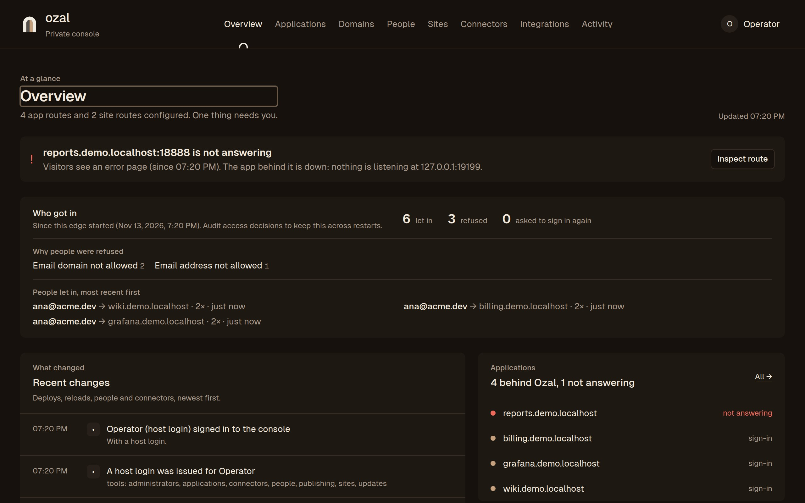
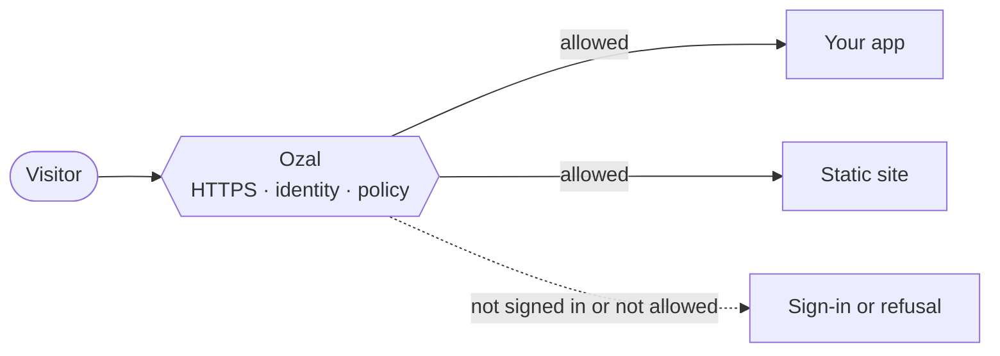

<p align="center">
  
</p>

<h1 align="center">Ozal</h1>

<p align="center">
  <strong>One front door for your self-hosted apps.</strong><br>
  Give an app a hostname, serve it over HTTPS, and decide who gets in with passkeys or your own identity provider. One Go binary.
</p>

<p align="center">
  <a href="https://ozal.dev">Website</a> ·
  <a href="docs/operations/first-application.md">First application</a> ·
  <a href="docs/operations/download-install.md">Install</a> ·
  <a href="docs/reference.md">Reference</a> ·
  <a href="docs/security.md">Security</a> ·
  <a href="VISION.md">Vision</a>
</p>

> **Alpha:** interfaces and config keys may change. Not production-ready yet.



*The console running on demo data: who reaches each app, and which route needs attention.*

## How it works



Ozal sits in front of your applications. It terminates HTTPS, checks who the visitor is, applies the route's rules, and only then forwards the request. For traffic that passes through Ozal, applications receive identity from the gateway, never from the client: client-supplied identity headers are stripped. Applications keep their own permissions; Ozal decides who reaches them, not what they do once inside. Protect the origin too: keep applications on loopback or a private network, so nothing can bypass the gateway.

## What it does

- **Publish an app in minutes.** Point a hostname at a local port or a static folder. Certificates are issued and renewed automatically.
- **Decide who gets in, per route.** Allow specific people, groups, or anyone signed in. Require a recent sign-in or a device-bound passkey for sensitive routes.
- **Passwordless by default.** Native passkeys, or an external OIDC provider. Ozal never stores passwords.
- **Ship static sites.** Upload a build or publish from GitHub Actions, with version history and one-click rollback.
- **See what happened.** Policy explanations and a live activity feed. A durable audit trail for access and admin changes is available when configured; the feed alone is not a tamper-evident record.
- **Operate from a console or the CLI.** The console is embedded in the binary and stays private on loopback or a local socket.

## Get started

Try it locally with an application already running on port 3000, using a binary built from this checkout:

```sh
go build ./cmd/ozal
./ozal setup -dir ./my-edge -target http://127.0.0.1:3000
```

This creates a new private installation and prints the start, invitation and sign-in commands. It does not overwrite anything, change DNS or expose the app to the Internet.

For a minimal routing example with no TLS and no identity provider, see [QUICKSTART.md](QUICKSTART.md). For a Linux service, follow [installation](docs/operations/download-install.md).

## Documentation

| I want to… | Read |
|---|---|
| Not sure where to begin | [Start here](docs/START-HERE.md) |
| Install Ozal and run it as a service | [Install](docs/operations/download-install.md) |
| Publish my first application or website | [First application](docs/operations/first-application.md) |
| Upgrade, back up, connect hosts, publish from CI | [Administration](docs/operations/administration.md) |
| Look up a config field or CLI command | [Configuration and CLI](docs/reference.md) |
| Understand the trust boundaries | [Security](docs/security.md) |
| Know where the project is going | [VISION.md](VISION.md) |

## Status

Capabilities below describe this checkout; tagged releases may include less.

| Area | State |
|---|---|
| Reverse proxy, HTTPS, per-route policy | Available |
| Passkeys and OIDC login | Available |
| Static sites with history and rollback | Available |
| Publishing without a public address (Cloudflare Tunnel) | Available; Ozal creates the tunnel, you run `cloudflared` |
| Signed identity assertion for applications | Available, per route |
| Owned tunnels to private connectors | Experimental, off by default |
| Signed releases and in-place updates | Signed pre-releases published; `ozal update` is alpha |
| High availability, DDoS protection, CDN | Not offered |

Each release lists its changes and fixes on [GitHub Releases](https://github.com/ozal-project/ozal/releases). The [alpha.1 notes](docs/releases/v0.1.0-alpha.1.md) record the first tagged build and its known limits.

## Contributing

```sh
go build ./cmd/ozal
scripts/verify.sh
```

Start with [AGENTS.md](AGENTS.md), then the [design](docs/architecture/design.md) and [engineering guide](docs/engineering.md). The console source is in `web/console`, the public site in `site`, and the security decisions live in Go.

Report vulnerabilities privately, as described in [SECURITY.md](SECURITY.md).
