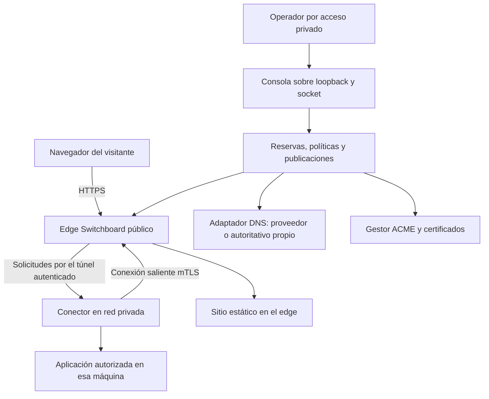

# Propuesta: publicación autónoma con Switchboard

Fecha: 2026-10-27, America/Asuncion. Estado: **propuesta para lectura del
mantenedor; implementación y ampliación de alcance pendientes de decisión**.
Seguimiento único: `ARCH-010` en [TO_IMPLEMENT.md](../TO_IMPLEMENT.md).

## 1. Qué estamos intentando resolver

Una persona debería poder instalar Switchboard, conectar una aplicación y
obtener una dirección HTTPS con acceso controlado desde nuestro producto.
La experiencia no debería exigir aprender Cloudflare, trasladar allí su
dominio ni crear un túnel en una plataforma ajena.

La propuesta es que Switchboard gestione el circuito completo: incorporación
del servidor público, conexión de la máquina privada, asignación de nombres,
certificados, políticas, diagnóstico y recuperación. Cloudflare queda como
una integración elegible. La meta no se cumple simplemente ocultando su API
detrás de nuestra consola: el circuito básico debe funcionar cuando no existe
ninguna cuenta, credencial, zona DNS ni conexión a Cloudflare.

Hay dos resultados de producto relacionados:

1. **Instalación autónoma:** una persona administra su dominio y uno o más
   servidores. Una configuración inicial habilita nuevas aplicaciones con
   nombres y HTTPS automáticos. El software funciona sin nuestros servidores.
2. **Direcciones provistas por un operador:** alguien que no tiene dominio o
   servidor conecta su máquina a una instalación que sí los tiene y recibe
   un subdominio. Podemos ser ese operador en un piloto, o puede ser una
   organización que instala Switchboard para sus miembros.

Recomiendo construir primero la instalación autónoma completa y después un
piloto cerrado del segundo resultado. Diseñar desde el principio la separación
de autoridad evita que el piloto obligue a rehacer el núcleo. Ofrecer cuentas
abiertas a cualquiera sería una decisión posterior, con operación y presupuesto
propios. La versión autoalojada debe seguir siendo útil por sí misma.

## 2. Qué podemos administrar y qué sigue necesitando Internet

| Pieza | Responsabilidad propuesta de Switchboard | Requisito que permanece |
|---|---|---|
| Dirección de una aplicación | Asignar un subdominio de una zona autorizada o asociar un dominio existente | Alguien registra y renueva el dominio padre; no podemos apropiarnos de nombres ajenos |
| DNS | Crear, comprobar y retirar los registros propios; opcionalmente administrar una subzona delegada con software DNS autoalojado | La delegación inicial requiere autoridad en el dominio padre y DNS público disponible |
| HTTPS público | Emitir, renovar, almacenar y recuperar certificados automáticamente | Una CA pública y la validación de control; nuestra CA privada no es confiable en navegadores por defecto |
| Conectividad desde casa | Conector saliente autenticado hacia un edge público | Algún servidor alcanzable desde Internet y una conexión saliente desde la casa |
| Identidad y permisos | Usuarios, passkeys, sesiones, políticas, revocación y explicación | Entrega de correo solo si se elige ese método; OIDC externo opcional |
| Tráfico y protección | Proxy, cuotas, límites, controles de aplicación y evidencia | Capacidad del enlace y mitigación aguas arriba para ataques que lo saturan |
| Disponibilidad | Recuperación, límites, reintentos y herramientas de operación | Servidores, backups, monitoreo externo y una persona responsable de incidentes |

Un usuario final puede recibir un subdominio sin comprar un dominio propio.
El operador de esa instalación sí necesita controlar el dominio del que salen
esas direcciones. Comprar automáticamente dominios nuevos implicaría contratos
con registradores, pagos y renovaciones; queda fuera de esta propuesta inicial.

## 3. Estado comprobado en el repositorio

La revisión es de código y documentación local, incluyendo trabajo sin commit.
No es una nueva comprobación de producción. Algunas entradas históricas se
contradicen respecto a despliegues; no se usan como inventario operativo actual.

| Área | Base existente | Distancia al resultado propuesto |
|---|---|---|
| Entrada directa | `cmd/switchboard/main.go`: HTTPS con autocert y listener HTTP para validación/redirección | Aceptación externa limpia, diagnóstico integrado y perfil directo explícito |
| Nombres nuevos | `routeHostPolicy` y `certs.AutomaticName` siguen las rutas autorizadas | Control de reservas, cuotas, propiedad y desasociación de dominios |
| DNS de visitantes | `internal/domaincheck`, `internal/admin/domains.go`, configuración `dns.target` | La creación automática hoy solo tiene adaptador Cloudflare |
| DNS-01 | `internal/certs`: cliente ACME, almacenamiento y renovación; puerto `DNSProvider` | El composition root construye Cloudflare; faltan selección y aceptación de otra implementación |
| Túneles | `internal/tunnel`: mTLS, yamux, registro, reconexión, revocación y rutas integradas | El listener actual acepta loopback/red privada; no es un ingreso público genérico listo |
| Incorporación | `TUN-004`, `internal/tunnelrenew/onboarding.go` y guía de conectores | Automatización completa en una segunda máquina y renovación genérica, sin los supuestos del piloto |
| Autenticación | Identidad nativa, passkeys, OIDC opcional y políticas | Privadas en dominios independientes: validación actual exige cobertura por `auth.cookie_domain` |
| Administración | Consola y API sobre loopback/socket, administradores separados de visitantes | No existe autorización para publicar la API administrativa como parte de un servicio compartido |
| Publicación estática | Pages, archivos inmutables y entrega de artefactos | Completar aceptación de CI y recuperación existentes; no agregar builds al edge |
| Operación | Instalación/upgrade, `sbctl`, eventos y contratos de backups/auditoría | Aceptación por otro operador y recuperación completa en host limpio |

Referencias: [main.go](../../cmd/switchboard/main.go),
[tunnel.go](../../internal/config/tunnel.go),
[config.go](../../internal/config/config.go),
[servicio de dominios](../../internal/domaincheck/probe/service.go),
[puerto DNS](../../internal/certs/issuer.go).

No propongo escribir de nuevo el proxy, el transporte multiplexado, ACME,
WebAuthn ni el motor de políticas. Propongo completar sus contratos y coordinar
su ciclo de vida alrededor de una publicación.

## 4. Relación con las decisiones vigentes

[Posicionamiento y portabilidad](positioning-and-portability.md) prioriza
autoalojamiento y proveedores reemplazables, y excluye DNS autoritativo nuevo y
un runtime distribuido del alcance inicial. La [coexistencia con
Cloudflare](cloudflare-coexistence.md) conserva requisitos de seguridad para el
modo detrás del proxy. Esta propuesta desarrolla una alternativa propia y
somete a revisión dos ampliaciones: subzonas DNS autoalojadas y direcciones
ofrecidas a otros usuarios.

Escribir este documento no aprueba esas ampliaciones, no cambia los perfiles
de confianza vigentes y no autoriza mover DNS ni abrir listeners. Al aceptar
una etapa se reconciliarán VISION, stack y tracker. Los bloques siguientes son
descomposición de diseño de `ARCH-010`, no un segundo backlog con estados.

## 5. Modalidades de instalación

| Modalidad | Qué aporta el operador | Qué recibe quien publica | Uso esperado |
|---|---|---|---|
| Local/privada | Máquina y acceso privado | Prueba local; no se promete URL pública | Evaluación y herramientas internas |
| Edge autónomo | VPS/IP pública y dominio o subzona | URLs automáticas bajo su zona | Base recomendada para organizaciones y homelabs |
| Edge para una comunidad | Lo anterior y autoridad sobre los participantes | Subdominios y conectores limitados por participante | Equipo, laboratorio o piloto cerrado |
| Servicio público del proyecto | Infraestructura, soporte, límites y gestión de abuso | Conectar y recibir una URL sin dominio propio | Posible fase futura, requiere decisión explícita |

La primera versión objetivo cubre Linux/systemd para el edge. Cada sistema y
arquitectura del conector se anuncia solo cuando tiene instalación y pruebas
reales; compilar para Windows no demuestra que el servicio funcione allí.

## 6. Arquitectura recomendada

DNS informa al navegador dónde está el edge; no transporta el tráfico HTTP.
El conector inicia el túnel: no se exige entrada pública a la máquina de casa.
El edge termina HTTPS y, por tanto, puede ver el tráfico en claro dentro del
proceso. Debe explicarse a quienes usen un edge ajeno. mTLS protege el tramo
edge–conector y no convierte al operador del edge en un tercero sin acceso.

### 6.1 Roles y límites

- **Edge:** TLS público, pipeline, políticas, rutas y presupuesto de recursos.
- **Conector:** clave local, identidad enrolada y destinos exactos permitidos.
- **Coordinación de publicación:** reserva nombres, prepara cambios, observa
  resultados y activa la publicación; inicialmente vive en el mismo proceso.
- **DNS:** adaptador hacia proveedor o servicio DNS autoritativo separado.
- **Operador:** configura autoridad, infraestructura y recuperación.
- **Participante, si existe esa modalidad:** publica solo recursos y nombres
  concedidos. No recibe un token de administrador del edge.

Mantener Go, SQLite, el binario de Switchboard y la consola embebida para la
instalación individual. DNS autoritativo sería un servicio opcional del perfil
avanzado, instalado y actualizado por el plano de host. Switchboard expresa
intención DNS; Server Ops o las herramientas del operador gestionan procesos,
puertos, backups y unidades. Sin panel de control de procesos dentro del producto.

## 7. Nombres y DNS: cómo dejar de configurar cada aplicación a mano

### 7.1 Camino inicial: una zona para aplicaciones

Ejemplo documental, no dominio disponible: `apps.example.org`.
El operador prepara una vez el wildcard DNS que apunta al edge y el método
para emitir certificados. Después `grafana.apps.example.org` y
`wiki.apps.example.org` se asignan desde Switchboard sin pedir un registro
nuevo para cada app.

Wildcard DNS y wildcard TLS son cosas distintas. El primero hace resolver
nombres; el segundo cubre nombres en un certificado. Un wildcard TLS cubre
un nivel, no el nombre base ni cualquier profundidad. Los nombres desconocidos
siguen rechazados por el edge aunque resuelvan por el wildcard DNS.

Dos alternativas para HTTPS:

1. Certificados por nombre con HTTP-01: primera instalación independiente de
   una API DNS. Se limita la emisión a nombres reservados y activados por una
   autoridad autenticada; nunca se emite por cualquier SNI recibido.
2. Certificado wildcard mediante DNS-01: conveniente al crear muchas URLs,
   pero necesita actualización automática de TXT. El riesgo de su clave se
   limita a una zona y a los edges que deban servirla.

HTTP-01 necesita puerto 80 y no emite wildcard; DNS-01 permite wildcard y
delegar la validación mediante CNAME o NS. [Documentación de Let's
Encrypt](https://letsencrypt.org/docs/challenge-types/).

### 7.2 Adaptadores para proveedores

Separar dos capacidades: registros de visitantes y TXT para ACME. Compartir
normalización y validación, pero no exigir permisos de toda la zona para
resolver únicamente desafíos. La interfaz de cada consumidor permanece pequeña.

Agregar selección explícita de proveedor y capacidades: crear A/AAAA/CNAME,
crear/eliminar TXT, identificar registros, consultar cambios y gestionar TTL.
Cloudflare pasa a ser una implementación. Mantener instrucciones manuales
para proveedores sin API y migración compatible de las referencias actuales.

No construir veinte adaptadores antes de probar el circuito. Primera
aceptación alternativa: PowerDNS autoalojado por API privada; evaluar después
RFC 2136 con TSIG si usuarios reales necesitan interoperabilidad. No ejecutar
scripts arbitrarios del usuario dentro del edge para simular adaptadores.

### 7.3 Subzona delegada a infraestructura propia

Para administrar el DNS por nuestra cuenta, delegar una subzona destinada a
apps a servidores autoritativos operados por la instalación. La persona conserva
el DNS del resto del dominio y su correo. La delegación requiere una acción
inicial en el padre; ningún software puede eliminar ese requisito de autoridad.

Recomendación de diseño: integrar PowerDNS Authoritative como componente
opcional. Su API administra registros y material DNSSEC; debe permanecer en
una red privada o socket, detrás de un adaptador con autorización por zona.
PowerDNS también documenta actualizaciones RFC 2136 y controles TSIG.
[API oficial](https://doc.powerdns.com/authoritative/http-api/index.html),
[DNS UPDATE](https://doc.powerdns.com/authoritative/dnsupdate.html).

Antes de incorporarlo se evaluarán versión, mantenimiento, licencia y método
de distribución, se registrará en stack y se probará con su configuración real.
CoreDNS es otra opción para zonas basadas en archivos y transferencias; no se
asume equivalente a una API de administración de zonas sin evaluar el trabajo
adicional. [Plugin file](https://coredns.io/plugins/file/),
[transferencias](https://coredns.io/plugins/transfer/).

Contrato operativo de esta modalidad:

- Primario y secundario en dominios de fallo independientes; dos procesos en
  un mismo VPS no constituyen redundancia de DNS.
- DNS autoritativo por UDP y TCP 53; sin recursión abierta. Transferencias y
  actualizaciones limitadas a pares autorizados.
- Delegación NS y glue cuando corresponda; comprobar lame delegation, TTL,
  caché negativa y accesibilidad de cada servidor.
- Empezar con una subzona nueva. Si se introduce DNSSEC, gestionar DS en el
  padre, rollover, backups de claves y pruebas de validación. No desactivar
  DNSSEC existente para facilitar una migración.
- Usar registros wildcard cuando el mapa de nombres lo permita; no escribir
  DNS por cada petición ni vincular la salud de DNS al proceso HTTP del edge.
- Reservas de apps en Switchboard; contenido DNS servido en el autoritativo.
  Reconciliación entre ambos con versión e identificadores de propiedad.

### 7.4 Dominios personalizados

Permitir `panel.empresa.example` sin trasladar el dominio: pedir un CNAME al
edge o A/AAAA adecuados y una prueba de control vinculada al registro de la
instalación. La prueba lleva token aleatorio, expiración y propósito; el
hostname nunca se reasigna solo porque un CNAME antiguo siga apuntando allí.

Para el apex, un CNAME tradicional puede entrar en conflicto con registros
necesarios de la zona; ofrecer A/AAAA o capacidades equivalentes del proveedor
solo cuando estén comprobadas. No prometer un único CNAME universal para apex.
Consultar CAA y explicar impedimentos de emisión. IDN se normaliza de manera
consistente; inicialmente se puede limitar la elección de nombres a ASCII
seguro y mostrar el hostname normalizado antes de guardar.

Retirar un dominio requiere desactivar rutas, invalidar pruebas y concesiones,
retener una reserva de seguridad y explicar los registros que siguen en DNS.
Un dominio sin dueño activo no debe terminar en una app de otro participante.

## 8. URL automática para personas sin dominio

### 8.1 Instalación de una sola autoridad

El operador habilita un pool bajo su zona y elige nombres automáticos o
reservas legibles. La aplicación recibe algo como
`grafana.apps.example.org`, con política privada por defecto. El nombre es
estable mientras dure su concesión; mover de IP no necesita cambiarlo.

La asignación lleva propietario, aplicación, fecha, estado y condiciones de
retirada. Colisiones y solicitudes concurrentes se resuelven transaccionalmente.
Reservar nombres de infraestructura: login, administración, correo, DNS,
verificación y soporte. El control de nombres no se deriva de un email ni del
nombre declarado por el conector.

### 8.2 Instalación con participantes independientes

Ampliación opcional de alcance: separar identidades y cuotas por participante.
Para un piloto, preferir una instancia y estado separados por participante,
con un ingreso común estrecho que solo enruta hosts autorizados. Esa separación
reduce cruces accidentales, pero no protege frente a quien controla el host
compartido y no reemplaza los límites de CPU, memoria y almacenamiento.

El ingreso común debe conservar SNI/Host y los contratos de IP; si termina TLS,
su afirmación de IP/identidad requiere un protocolo autenticado y pruebas, no
confianza genérica en `X-Forwarded-For`. No copiar SQLite entre procesos activos.
No hay consola de flota ni cuentas públicas implícitas en el binario individual.

Nombres ilustrativos: `app-7h2k.workspaces.example.org` o una subzona por
participante. La elección final debe contemplar cookies, sitios web no
confiables, certificados y Public Suffix List antes de publicar contenido de
terceros. No se comparte cookie `Domain` en el padre entre participantes.
Separar dominio de control, login y contenido; cookies de host, CSRF y validación
de origen siguen siendo necesarios aunque los nombres sean diferentes.
[Public Suffix List](https://publicsuffix.org/list/).

No anunciar "gratis e ilimitado": asignar explícitamente ancho de banda,
conexiones, nombres, almacenamiento y vencimiento. El participante debe poder
exportar configuración y retirar su conector. Si se usan dominios nuestros,
dejar de operar el servicio afecta esas URLs; la autoalojabilidad del software
no convierte esos nombres en portables sin cooperación del dueño del dominio.

## 9. Túnel propio por Internet

### 9.1 Límite actual que hay que resolver

`internal/config/tunnel.go` admite loopback o una red RFC1918/ULA explícita.
El piloto usa red privada. Quitar esa validación no constituye una solución
de ingreso público. Hay que definir un perfil de transporte público, sus
credenciales, presupuestos y recuperación.

### 9.2 Propuesta de transporte

Conservar yamux sobre TLS 1.3 mutuo. Primero aceptar un puerto TCP público
dedicado de túnel en el edge, configurado explícitamente; aplicación y consola
mantienen sus límites. El conector valida el nombre y la CA esperados del
edge y este valida cadena, enrolamiento activo y alcance del conector.

Un puerto dedicado puede estar bloqueado en redes corporativas. Posteriormente
evaluar transporte sobre HTTPS/WebSocket en 443 para esas redes. Compartir
443 con HTTP requiere diseño de multiplexación y pruebas con proxies reales;
no se promete simplemente cambiar el número de puerto. QUIC no es necesario
para la primera entrega y no resuelve todos los bloqueos de salida.

La conexión pública tendrá límites antes y después de autenticación:
handshakes simultáneos, tiempos de lectura, sesiones por identidad, streams,
buffers, tamaño de metadatos, colas y bytes transferidos. Rechazar duplicados
de forma determinista y no desplazar un conector válido con uno no autorizado.

### 9.3 Incorporación y claves

1. El operador crea una invitación de conector con recursos autorizados y
   vencimiento breve; el material de incorporación no se envía en logs.
2. La máquina destino genera su clave y CSR localmente.
3. La invitación se canjea una sola vez y la solicitud queda ligada a la clave,
   instalación y alcance. Un CSR no elige por sí solo sus permisos.
4. El firmante verifica autoridad y concede un certificado limitado. Raíz
   fuera de línea; intermedio limitado si se aprueba firma automática en línea.
5. El conector establece mTLS, anuncia exclusivamente los recursos concedidos
   y la consola observa la sesión autenticada.
6. Una solicitud real atraviesa el túnel antes de marcar el destino conectado.

La invitación debe autorizar también dónde puede canjearse; no seguir enlaces
a endpoints arbitrarios entregando secretos. El cliente verifica TLS público
del enrolamiento y el anclaje del edge desde una fuente autenticada. Dar acceso
a la interfaz no sustituye la prueba criptográfica.

### 9.4 Renovación y revocación

Renovación por identidad activa, prueba de posesión y alcance inmutable salvo
decisión administrativa. Rotación con solapamiento acotado y transacción que
impida reactivar identidades revocadas. Retener estado recuperable si se corta
el proceso entre generar, registrar y activar. La renovación del piloto
dependiente de roles específicos y SSH no se considera el servicio genérico.

Revocación cierra sesiones y rechaza reconexión dentro de un objetivo inicial
de cinco segundos, que debe medirse con tráfico activo. Rotación de CA necesita
distribución de confianza previa y período de doble anclaje, no renovación
automática de hojas como sustituto. Proteger el firmante de CA no depende de
que el listener público tenga TLS.

## 10. HTTPS y autenticación en dominios diferentes

### 10.1 Certificados como recurso con ciclo de vida

Cada publicación declara qué nombres necesita y el mecanismo de validación.
El gestor limita órdenes simultáneas y tasas por instalación/zona/cuenta,
comparte desafíos cuando sea seguro y respeta reintentos del servidor ACME.
No emitir un certificado por cada reintento del navegador.

Persistir cuenta ACME, generaciones completas y limpieza de TXT. Ante fallo de
renovación conservar un certificado válido; sin uno válido no pasar a HTTP
inseguro. Staging y producción usan estados separados. La vigencia se obtiene
del certificado real y no se codifica como noventa días.

Si wildcard cubre nombres de varios participantes, la clave permanece en el
edge y su compromiso afecta a todos esos nombres. Para aislar claves, usar
certificados por participante/nombre o edges separados; medir tasas y carga.

### 10.2 Sesiones por host y login central

La solución propuesta para múltiples dominios conserva un login central de la
instalación, donde viven las passkeys. Cada aplicación recibe su propia cookie
de host. El navegador no puede compartir una cookie entre dominios arbitrarios.

Flujo propuesto, sujeto a revisión específica antes de implementar:

1. La app crea una transacción de login con estado aleatorio y verificador
   local; guarda la relación de forma segura y redirige al login autorizado.
2. El login autentica con el método elegido y valida instalación, aplicación,
   callback exacto y transacción, incluyendo su vínculo con ese navegador.
3. Devuelve un código opaco de un uso y vida breve, ligado a audiencia, callback,
   transacción y prueba de posesión del verificador. No devuelve la sesión central.
4. El handler de la app canjea el código y crea una sesión de host con atributos
   seguros. Limpia la URL y redirige solo a un destino previamente permitido.
5. Cada solicitud aplica la política vigente. Deshabilitar una persona o quitar
   membresías no espera a que expire una cookie vieja.

El diseño tomará controles del flujo authorization code con PKCE y las buenas
prácticas OAuth, usando bibliotecas existentes cuando corresponda. Esto no
declara a Switchboard proveedor OIDC para otras apps: `ID-004` sigue teniendo
su alcance separado. [RFC 9700](https://www.rfc-editor.org/rfc/rfc9700).

Definir logout local, logout de toda la instalación, invalidación y expiración.
En el perfil de un proceso se usan referencias y transacciones locales para
evitar inventar verificación de tokens distribuida. Autenticación entre
instalaciones diferentes queda fuera: no compartir usuarios por coincidencia
de email ni usar la sesión de un participante para otro.

Mantener los RP ID actuales durante migración. Cambiar de dominio de passkey
requiere enrolamiento controlado; no se migran credenciales por copiar filas.
Probar navegación móvil, cookies SameSite, callbacks, CSRF, código robado,
reutilización y limpieza de sesión. No eliminar la validación `cookie_domain`
hasta que el nuevo mecanismo cubra el caso que hoy rechaza.

## 11. Experiencia completa que debería ver el usuario

### 11.1 Primera instalación del operador

1. Descargar versión verificable e instalar el servicio con estado privado.
2. Abrir la consola por el mecanismo privado existente y registrar al operador.
3. Elegir "Publicar desde este servidor" o "Conectar una máquina a un servidor
   Switchboard existente". Explicar qué máquina necesita IP pública.
4. Configurar una zona: proveedor integrado, registros manuales o delegación
   a DNS propio. Mostrar permisos mínimos y cambios exactos antes de aplicarlos.
5. Verificar entrada desde fuera para IPv4 e IPv6 cuando estén anunciadas.
   Una prueba desde el mismo servidor no se etiqueta "comprobado en Internet".
6. Emitir el certificado, publicar una app de prueba privada y comprobar visitas
   permitidas y denegadas antes de ofrecer el resto de la instalación.
7. Mostrar cómo exportar estado, recuperar el acceso y retirar la configuración.

El producto no debe pedir copiar claves privadas ni tokens en el chat.
Credenciales por referencias locales o un flujo de autorización soportado por
el proveedor; la consola nunca persiste los valores resueltos en configuración.

### 11.2 Agregar una aplicación

"Agregar aplicación" pide origen —sitio estático o servicio existente—,
máquina destino, nombre y personas/grupos autorizados. Ofrece "Usar una
dirección de esta instalación" o "Conectar mi dominio". Privada por defecto.

Al confirmar se prepara una publicación y aparece progreso con resultados
concretos: nombre reservado, destino conectado, DNS observado, HTTPS listo,
política activa y solicitud de prueba recibida por la instalación correcta.
Cada problema muestra causa, antigüedad de la observación y acción posible.
"Esperando DNS" no se confunde con un fallo de contraseña o del túnel.

Publicar contenido de otra persona no abre administración. La consola actual
sigue privada; una futura API pública de enrolamiento/publicación debe tener
superficie, identidad y límites propios. No es un proxy genérico a `/_/api/*`.

### 11.3 Compartir temporalmente

Reusar el concepto de `TUN-003`: nombre con concesión breve, lista de acceso,
TTL máximo, revocación y límites. Si el conector desaparece, se corta el
tráfico y la concesión vence; no se reasigna inmediatamente a otro usuario.
Que una URL sea difícil de adivinar no constituye autenticación.

La afirmación firmada y la verificación en el agente que prevé `TUN-003`
deben conservar su propio contrato de audiencia/expiración/replay. No se
sustituyen silenciosamente por los headers autenticados del túnel persistente.

## 12. Estado, consistencia y recuperación de publicaciones

Una publicación necesita identificador estable, dueño, hostname normalizado,
origen, política, revisión y referencias a DNS/certificado/conector. Sus
observaciones llevan origen y tiempo: esperado, observado y activo son distintos.

Estados conceptuales: borrador, reservado, preparando, verificando, activo,
degradado, suspendido y retirado. Una publicación activa puede degradarse si
el túnel cae sin perder propiedad del nombre ni convertir el recurso en público.

SQLite guarda intención y operaciones pendientes; configuración mantiene su
autoridad actual sobre rutas/políticas. Diseñar qué estado pasa a runtime
antes de migrarlo, con una sola autoridad por dato. No tener dos escritores
independientes de rutas. La API usa revisión esperada para rechazar cambios
obsoletos y claves de idempotencia para operaciones reintentadas.

DNS, ACME, archivos y base de datos no tienen una transacción común. Aplicar
una operación por etapas con registro durable: reservar, preparar destino,
escribir recursos externos propios, validar y activar un snapshot completo.
En caso de error, reconciliar y deshacer solo lo que esa operación creó.
Una respuesta perdida no prueba que el proveedor no haya creado el registro.

No cambiar una app sana por un candidato incompleto. Mantener la versión
anterior hasta aceptar la nueva; cancelar una llamada HTTP del navegador no
asegura rollback del servidor. La consola consulta el resultado durable.

Invariantes que deben convertirse en regresiones:

- Un hostname tiene una sola asignación activa por instalación.
- Cada solicitud atraviesa el pipeline de confianza y política existente.
- Una publicación privada incompleta nunca se sirve como pública.
- Ni Host ni SNI recibidos de Internet autorizan reservas o emisión ACME.
- Un conector solo abre destinos y recursos enrolados; no es un proxy abierto.
- Revocar tiene efecto tanto en tráfico activo como en nuevos intentos.
- Los fallos de un proveedor no activan un ingreso alternativo más permisivo.
- Un cleanup no elimina registros o certificados de otra operación.

## 13. Seguridad y aislamiento

| Riesgo | Control propuesto | Prueba necesaria |
|---|---|---|
| Robo/reasignación de dominio | Prueba ligada a propietario, revisión y cuarentena tras retirada | CNAME colgante y prueba vieja no permiten reclamarlo |
| Emisión masiva de certificados | Solo nombres aprobados, cuotas y scheduler acotado | SNI aleatorios y reintentos no crean órdenes |
| Escalada de conector | CSR validado y alcance definido por autoridad | Identidad válida de un recurso no abre otro |
| Spoofing de identidad/IP | Trust stage existente, mTLS y metadatos autenticados | Headers con guiones/underscores, duplicados y peers no confiables |
| SSRF mediante verificación | Destinos autorizados, resolución/pinning por intento, redirects acotados | DNS rebinding, metadata endpoints, loopback y redes privadas según perfil |
| Colisión entre participantes | Estado/secretos separados, rutas por dueño y cuotas | Participante A no enumera, cambia ni lee recursos de B |
| Cookies entre sitios no confiables | Host-only, dominios de control separados y defensa CSRF | Cookie tossing, callbacks cruzados y solicitudes same-site maliciosas |
| Abuso del túnel | Cuotas, backpressure, plazos y límites antes de autenticar | Streams lentos, handshakes incompletos y colas llenas |
| Compromiso DNS/CA | Privilegios mínimos, credenciales separadas y rotación | Token de una subzona no cambia el padre ni otra zona |
| Acceso al origen por otra vía | Aplicación en loopback/red privada y acceso limitado al conector | Dirección/IP alternativa no evita los controles acordados |
| Fuga por logs | Eventos con códigos, sin secretos ni contenido de requests | Errores de proveedor y datos maliciosos no filtran valores |

Algunas pruebas necesitan permitir loopback en un laboratorio. Eso no habilita
el mismo destino en un verificador público. El perfil determina las redes
permitidas; se evita ampliar SSRF para hacer funcionar la prueba.

## 14. Escalabilidad: tres problemas diferentes

### 14.1 Muchas instalaciones independientes

No comparten base ni dependen de una API central del proyecto. Cada operador
dimensiona su edge; descargar releases y consultar documentación no se vuelven
dependencias del camino de una solicitud. Telemetría remota no es requisito.

Este modelo permite crecer en adopción sin que vos pagues todo el tráfico.
Su costo central está en mantener software, versiones, compatibilidad y soporte.

### 14.2 Una instalación con más tráfico

Empezar con un edge y medir streams, ancho de banda, handshakes TLS, memoria,
CPU, escrituras SQLite, descriptores y latencias. Separar la latencia de red
del costo del proxy. El ancho de banda residencial sigue limitando apps en casa;
los archivos estáticos pueden servirse desde el edge sin depender del homelab.

Presupuesto experimental para el primer laboratorio, **no capacidad prometida**:
100 conectores, 1.000 hostnames configurados, 500 streams concurrentes y cargas
HTTP de 10/50/100 solicitudes por segundo. Variar independientemente tamaño de
respuesta, duración, WebSocket y número de handshakes. Ajustar al host disponible;
si no alcanza, registrar capacidad inferior en lugar de reducir el test ocultamente.

Objetivos de evaluación propuestos: overhead p95 menor a 20 ms en el laboratorio
con red controlada, errores atribuibles al gateway inferiores al 0,1% dentro
del sobre medido y memoria estable en una prueba de una hora. Registrar p99,
GC, base de comparación, tamaño de respuesta, CPU/RAM y versiones. Repetir
solo después de cambios relevantes o resultados sin resolver.

### 14.3 Servicio compartido con muchos participantes

El límite pasa a ser también costo, abuso, aislamiento y soporte. Repartir
participantes por edge asignado es más sencillo que comenzar con active-active.
Cada grupo de estado tiene un escritor y un mecanismo de backup/restore claro.

Agregar alta disponibilidad real requiere decidir propiedad de conexiones,
sesiones, revocaciones, certificados y failover. SQLite compartido por NFS o
copiado entre edges no es esa solución. Evaluar Postgres y coordinación solo
cuando se apruebe multi-edge; el laboratorio `LAB-014` no autoriza adoptarlo
como requisito del producto individual.

DNS con varios A/AAAA tampoco garantiza failover ni sesiones consistentes.
Un edge alternativo necesita túneles y estado listos y ausencia de dos
autoridades contradictorias. En un primer release preferir recuperación
documentada y medida a prometer disponibilidad que no existe.

## 15. Costos y responsabilidad operativa

No se fijan precios de proveedores: estas son partidas y fórmulas de
presupuesto, no cotizaciones. Antes de contratar se investigan precios,
egreso incluido, límites, impuestos y condiciones actuales.

| Perfil | Recursos a presupuestar | Quién asume la carga |
|---|---|---|
| Autoalojado mínimo | Dominio anual, un VPS con IP pública, backup externo; DNS existente | Cada operador |
| DNS propio resistente a un fallo | Dos ubicaciones DNS independientes, transferencia/backup y observación | Operador de la zona |
| Piloto compartido | Edge(s), dominio dedicado de contenido, aislamiento por participante, egreso y soporte | Quien ofrece URLs |
| Servicio abierto | Lo anterior más guardias, abuso, reputación, capacidad de contingencia y recuperación | Operación del servicio |

Fórmula mensual: cómputo + IP + almacenamiento + backups + DNS + egreso
excedente + observación + horas de operación + reserva de contingencia.

Ejemplo aritmético: 100 apps × 1.000 visitas/día × 1 MB transferido/visita son
aproximadamente 100 GB/día, o 3 TB en treinta días, antes de overhead y backups.
No son estimaciones de demanda ni de throughput. El túnel puede sumar egreso
en otros hosts; no contar el tráfico de todos los tramos como una sola factura.

El piloto debe tener techo mensual de dinero y horas. Definir qué ocurre al
alcanzarlo: limitar nuevas publicaciones, avisar y aplicar cuotas acordadas;
no degradar una app privada a pública ni borrar datos por falta de presupuesto.

Copias y recuperación incluyen DB consistente, intención/runtime, referencias
de credenciales, secretos externos necesarios, cuentas ACME, certificados,
autoridad de conectores y zonas DNS. Una restauración debe tratar revocaciones
posteriores al backup: no reactivar credenciales robadas ni nombres retirados.
Ante incertidumbre, renovar/re-enrolar y exigir login en vez de aceptar estado
antiguo como autoridad vigente.

## 16. Secuencia de implementación y entregables

Estimaciones orientativas de trabajo técnico concentrado, sin garantías de
calendario; incluyen implementación y verificación, excluyen esperas externas.
Reestimar cada bloque con los hallazgos anteriores. Las decisiones y prioridades
del mantenedor pueden cambiar el orden. El agente implementa core, adaptadores,
pruebas, integración y documentación completos de cada bloque aprobado.

### Etapa A: circuito propio mínimo sin Cloudflare — 2 a 4 semanas

Reutiliza `EDGE-006`, `EDGE-001`, `UI-006`, `PAGES-009`, `REL-010/012/013`.
Primero inventariar en un entorno aislado todas las conexiones y referencias
específicas al proveedor. Definir perfil directo sin certificado de origin-pull
de Cloudflare; preservar el perfil protegido existente como configuración distinta.

Entregar zona de apps con DNS wildcard manual inicial, HTTP-01 por nombre,
asignación/reserva de nombres y asistente de publicación recuperable. La prueba
de independencia utiliza DNS autoritativo ajeno a Cloudflare y un CA ACME de
pruebas local; luego una CA pública en staging y producción por separado.

Salida: otro operador instala un edge, crea dos apps bajo su zona desde la
consola y obtiene HTTPS; DNS, tráfico, transporte y emisión no usan Cloudflare.
Esto aún necesita resolver transporte privado existente o apps en el edge;
el conector público genérico es la siguiente etapa.

### Etapa B: conector público e incorporación completa — 3 a 6 semanas

Reutiliza `TUN-002/004`, renovación y contratos de `SHD-001`.
Entregar listener público explícito, incorporación de una sola vez, clave en
destino, alcance, reconexión, renovación genérica y revocación observable.
El firmante y su almacenamiento se revisan antes de habilitar enrolamiento.

Salida: una máquina de una segunda red, sin VPN previa ni entradas abiertas,
publica una app a través del edge; caída de red, reboot, renovación y
revocación pasan con tráfico. Si el puerto está bloqueado, se informa el límite;
la compatibilidad de salida 443 es una extensión medida, no una promesa tácita.

### Etapa C: autenticación multidominio — 3 a 5 semanas

Se apoya en `ID-014`, `UI-006`, `PAGES-009`, `ID-012` y la autoridad de sesiones.
Antes de implementar, documento corto del protocolo, amenazas y migración de
cookies/passkeys. Entregar transacciones, códigos de uso único, cookies por
host, revocación y logout coherentes.

Salida: apps privadas en dos dominios independientes admiten al usuario
correcto y rechazan callbacks/tokens cruzados; el RP de login sigue controlado
por la instalación. Operación existente conserva una migración soportada.

### Etapa D: DNS administrado por la instalación — 2 a 4 semanas

Extiende `PAGES-009`, `EDGE-006/007/002`; nueva dependencia solo después de
registrar evaluación en stack. Entregar adaptador PowerDNS, capacidades
separadas de A/AAAA/CNAME y TXT, subzona delegada, reconciliación y DNS-01.

Salida: instalación desde cero con autoritativos propios; crear apps no requiere
editar DNS ni dar permisos del dominio padre; emisión, renovación, caída de
primario y recuperación preservan registros ajenos. No cambiar NS/DS de un
dominio real como parte de la prueba local.

### Etapa E: confiabilidad y migración del piloto propio — 2 a 4 semanas

Integra `LAB-001/002/003/004`, `SHD-001`, `AUD-*` y tareas operativas existentes.
Entregar pruebas de carga/fallo, exportación/restauración, cuota de recursos y
guía para migrar de Cloudflare por un hostname controlado. La migración pública
requiere autorización de despliegue; no se deduce de aprobar el código.

Salida: el servicio real elegido cumple los presupuestos declarados y se
recupera en otro host. Objetivos iniciales sugeridos para medir: RTO de 60 min
y RPO de configuración/publicaciones de 24 h; revocaciones y credenciales
requieren reconciliación específica antes de reabrir, aunque eso prolongue RTO.

### Etapa F: URLs para participantes invitados — 4 a 8 semanas adicionales

Solo si se acepta la ampliación de alcance. Entregar invitaciones de
participante, recursos separados, asignación de nombres, cuotas, API limitada,
retirada y exportación. Primero 5–10 participantes invitados, sin registro
público. No reutilizar la identidad administrativa del edge como identidad
de cliente del servicio.

Salida: A no accede a B, un participante agotado no ocupa los recursos de
todos y una persona publica sin dominio propio ni cuenta de Cloudflare.
Medir soporte y egreso al menos durante un período acordado antes de abrir.

### Etapa G: compartir efímero y posible servicio abierto

`TUN-003` aporta shares; la apertura pública necesita una decisión separada
tras el piloto: presupuesto, reglas de uso, privacidad, abuso, eliminación y
responsables. La estimación se hace con datos del piloto; no se da por
incluida en F. La alta disponibilidad y una red geográfica también se estiman
y autorizan por separado.

El rango A–E suma aproximadamente 12–23 semanas de trabajo concentrado. No
equivale a prometer una fecha: la superficie de seguridad y la aceptación por
terceros pueden ampliar el esfuerzo. A+B ya entregan valor independiente;
C permite dominios privados arbitrarios y D evita depender de una API DNS
comercial en el perfil avanzado. No vender solo A como el resultado completo.

## 17. Mapa técnico y cambios previstos

| Componente | Cambio previsto | Regla arquitectónica |
|---|---|---|
| `internal/domaincheck` | Decisiones de reserva, propiedad y readiness con fuentes/fechas | Núcleo puro, sin DNS de red |
| Adaptadores de dominio/DNS | Capacidades, proveedores, reconciliación y pruebas externas | Interfaces del consumidor; HTTP/DNS fuera del core |
| `internal/certs` | Proveedor seleccionable, coordinación de nombres y presupuestos | Reusar cliente ACME y contrato de generaciones |
| `internal/tunnel` y renovación | Perfil público, alcance y enrolamiento/rotación genéricos | Transporte autenticado; goroutines cancelables |
| `internal/auth`, `internal/passkey` | Sesiones de host y transacciones multidominio | Decisiones puras, adaptación HTTP en el shell |
| `internal/routemanager` | Activar solo candidato completo y conservar revisión | Snapshot inmutable y swap atómico |
| `internal/store/sqlite` | Intención de publicación, reservas y operaciones durables | Migraciones numeradas, autoridad única por dato |
| `internal/admin`, `web/console` | Asistente, consecuencias, progreso y recuperación | Admin privado; acciones rutinarias desde web |
| `cmd/switchboard` | Construir adaptadores y perfiles | Único composition root |
| `sbctl`, instalación y documentación | Preparación reproducible y plan antes de aplicar | Control de host fuera del request path |

Los nombres finales de paquetes nuevos se deciden al refinar cada bloque.
No mover todo el repositorio para acomodar la propuesta ni modificar código
ajeno que actualmente esté sin commit.

## 18. Matriz de aceptación

| Escenario | Resultado exigido | Nivel de evidencia |
|---|---|---|
| Instalación limpia sin cuenta Cloudflare | URL, HTTPS y política funcionando | Segundo operador y red externa |
| Bloqueo de endpoints Cloudflare | El circuito básico sigue funcionando; no reintenta APIs opcionales | Laboratorio con política de egreso y DNS no Cloudflare |
| Apps nuevas bajo pool | Sin edición manual por app; unknown host rechazado | Integración y navegador |
| Dominio personalizado ajeno al pool | Propiedad verificada, TLS y login correcto | DNS público controlado |
| Dos privadas en dominios distintos | Cookies separadas, identidad correcta, sin callback abierto | Navegador y regresiones del protocolo |
| Máquina detrás de NAT/CGNAT | Conexión saliente; app sin entrada residencial | Otra red; describir si es NAT simulado o CGNAT real |
| Revocación de conector/usuario | Tráfico y reingreso bloqueados en el plazo publicado | Medición con conexiones activas |
| Certificado a renovar | Renovación y persistencia sin intervención | CA de prueba con vida corta; CA pública en etapas separadas |
| DNS/API/CA indisponibles | Estado claro; mantener servicio válido; sin fail-open | Fallo inyectado |
| Reinicio/kill/disco lleno | Sin estado mixto ni publicación accidental | Procesos y almacenamiento reales aislados |
| Restauración en host limpio | Nombre, rutas, secretos y revocaciones reconciliados | Drill con RPO/RTO medidos |
| Participantes A y B | Ninguna lectura/mutación cruzada | Pruebas negativas y navegador, solo etapa F |
| Carga declarada | Latencia, errores y memoria dentro del presupuesto | Informe reproducible con límites |
| Proveedor opcional ausente | Instalar y operar sin SDK, token o DNS específico obligatorio | Binario y configuración mínimos |

Cada bloque de código corre `scripts/verify.sh`, pruebas dirigidas de seguridad
y los escenarios que toca. Las decisiones puras llevan tablas/fuzz; adaptadores
usan servicios simulados y una integración real del componente elegido. La
consola se verifica en 1440/1024/390/320 px, teclado, axe y fallos/reintentos.
Tests locales no cierran certificados públicos, DNS real ni aceptación de otro
operador. Un ensayo de renovación acelerada tampoco prueba que ya transcurrió
la ventana real del certificado desplegado.

## 19. Migración gradual desde Cloudflare

1. Inventariar por hostname DNS, proxy, TLS, reglas, origin-pull, cliente IP y
   dependencias de aplicación. Capturar configuración mediante referencias
   seguras, sin imprimir secretos.
2. Crear entorno y hostname nuevos con DNS ajeno a Cloudflare. Probar el modo
   directo con su certificado público y túnel propios.
3. Aceptar seguridad, recuperación, renovación y capacidad antes de cambiar
   usuarios. No extrapolar los resultados de un sitio estático a una app privada.
4. Preparar perfil directo de confianza: retirar dependencia de origin-pull
   solo en el listener/entorno destinado a entrada directa, ajustar firewall
   y origen de IP. El perfil detrás del proxy mantiene su autenticación.
5. Si se migra DNS autoritativo, copiar y comprobar toda la zona necesaria,
   correo, CAA, NS/DS/DNSSEC y TTL. Preferir subzona al primer intento para
   reducir el alcance. Cambiar proxy y nameservers simultáneamente dificulta
   diagnosticar y revertir.
6. Programar cambio explícito y comprobar con resolvers/redes independientes.
   TTL bajo reduce algunas esperas; no garantiza propagación instantánea.
7. Mantener camino anterior durante la ventana acordada sin permitir que
   salte políticas. Registrar qué usuarios resuelven todavía direcciones antiguas.
8. Retirar recursos/credenciales del proveedor solo tras aceptación y plazo
   de rollback. Evitar credenciales y registros colgantes.

Rollback puede requerir restaurar DNS y perfiles de confianza; no es un botón
instantáneo por cachés. Si el origen directo no está aceptado, la caída del
proxy provoca indisponibilidad y no apertura automática del firewall.

## 20. Decisiones para que el mantenedor evalúe

| Decisión | Recomendación | Consecuencia |
|---|---|---|
| Resultado principal | Publicación autónoma completa A–E | Resolver experiencia y operación, además de quitar un proveedor |
| Usuarios sin dominio | Pool del operador; luego piloto invitado F | El operador controla el padre y responde por esas URLs |
| DNS propio | PowerDNS opcional y subzona delegada | Servicio adicional solo en perfil avanzado; evaluación de stack previa |
| Infraestructura del usuario | VPS/IP pública o edge de un operador elegido | No depender de un edge central obligatorio del proyecto |
| Dominios privados distintos | Login central y sesiones por host | Trabajo de protocolo y migración; evitar ampliar cookie_domain |
| Túnel público | TCP mTLS dedicado primero; evaluar 443 después | Menor complejidad inicial con límite de compatibilidad visible |
| Servicio compartido | Invitados e instancias separadas inicialmente | Más recursos por participante; menor superficie de estado compartido |
| Dominio del proyecto | Mantener control/login y contenido ajeno separados | Compra/elección posterior; ningún nombre real reservado por este documento |
| Alta disponibilidad | Recuperación medida primero; multi-edge tras demanda | Menor carga inicial, sin promesa de continuidad ante pérdida de edge |
| Cloudflare | Adaptador y proxy opcionales | Integración útil sin requisito para el circuito básico |

La decisión central es si el objetivo incluye **operar URLs para personas que
no aportan dominio ni servidor**, además de construir el software que cada
operador instala. Ambos caben en la arquitectura propuesta; el segundo exige
asumir infraestructura y responsabilidades continuas. Esta propuesta los
hace revisables por separado para que puedas elegir hasta dónde llevarlo.

## 21. Qué significaría terminar

Para A–E: otra persona instala y administra Switchboard, conecta una máquina
privada, publica con nombres y HTTPS automáticos, protege apps incluso en
dominios distintos, revoca y restaura, sin cuenta ni tráfico obligatorio hacia
Cloudflare ni servicios nuestros. El perfil de DNS propio permite administrar
su subzona con infraestructura controlada por esa persona.

Si se aprueba F: una persona invitada sin dominio ni servidor público recibe
una URL del operador, publica solo sus recursos y puede retirarse sin obtener
autoridad sobre otras personas. La instalación autoalojada continúa funcionando
sin el servicio compartido. Las capacidades se documentan con versiones,
evidencia y límites, y el seguimiento de implementación vive únicamente en
[TO_IMPLEMENT.md](../TO_IMPLEMENT.md).
