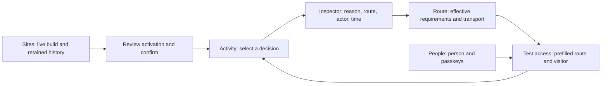

# Switchboard: product, code and UX review

Date: 2026-10-21. Reviewed baseline: `bd76729d60025f707c3d4ed1255f3972eb9a9f30`
plus the tracked working tree captured for this review. This is a product and
engineering assessment, with focused security-boundary inspection. It is not
a complete penetration test or public-deployment acceptance.

## Recommendation

Keep the Go runtime, SQLite, immutable routing snapshots, pure authorization
engine and embedded Svelte console. Evolve the product around three connected
operator journeys: **understand a refusal, grant or recover access, and change
a live site safely**. A rewrite would discard useful guarantees without
addressing the most immediate problems.

The current cool graphite identity is coherent and recognizable. Preserve it,
the neutral primary buttons and the amber brand lamp. Improve hierarchy,
density, mobile prioritization and state semantics before adding animation.
The console should make a decision easy to investigate and an operation easy
to verify. The public site should demonstrate those capabilities with current
evidence and an install path a new visitor can actually follow.

Implementation work belongs in [TO_IMPLEMENT](../TO_IMPLEMENT.md), not in this
dated review. No implementation, release, deployment or security task is closed
by this document.

## Scope and evidence

Reviewed surfaces: Go proxy/authentication/authorization and their boundaries;
admin handlers and event projection; Pages storage/deployment; connector
revalidation; Svelte shell and all five pages; native passkey pages; Astro
project site; build gate; architecture, identity and deployment documentation.
Inspection was concentrated on these paths rather than every line of every
package. Certificate work changing concurrently was preserved, not certified.

The checkout already contained changes to `cmd/switchboard/main.go`,
`internal/config/{config.go,dns01_test.go}`, nine `internal/certs` files and an
untracked `internal/certs/apex_test.go`. The executable snapshot copied 402
tracked files, excluding real configuration, credentials and key material;
the untracked test was not copied. Results describe that snapshot, not later
edits by another session.

Browser checks used the committed embedded console, Chromium, agent-browser
and axe-core 4.12.1, with a small **fixture API** inside an isolated loopback
namespace. Three fictional routes, one fictional user, two fictional site
deployments and synthetic SSE messages exercised UI behavior. No live control
plane, real identity, invitation or deployment was changed. This proves client
behavior under those responses; it does not prove the Go endpoints end to end.

| Evidence | Result / limit |
|---|---|
| Source inspection | Findings below include owning files and line references at this snapshot. |
| Console browser | Activity, People, Sites, Simulator and Routes exercised; replay, mutation, failure and recovery states checked. |
| Responsive checks | Activity at 1440×900; Simulator at 1024×768, 390×844 and 320×844; Routes at 390×844. No document-wide horizontal overflow in those samples. |
| Accessibility | Invitation output has an unnamed input; mobile Routes has a scrollable region without keyboard access. Activity and Simulator had no automated violations in their sampled states. Contrast checks were incomplete over gradient backgrounds. This is not WCAG conformance certification. |
| Public site / passkey pages | Source reviewed; build and isolated browser results recorded in the verification section below. |
| Security | Focused source review of identity/admin/proxy boundaries. No confirmed authorization bypass established. Cryptographic assurance, full TLS/ACME review, dependency-advisory validation and deployed configuration are outside this review's evidence. |

## What should survive the redesign

- One self-contained Go runtime; Node is a build-time dependency. The console
  is Svelte 5 + Vite + Tailwind/shadcn-svelte; the project site is static Astro.
- The real engine answers policy simulations. The UI never becomes a second
  policy evaluator. `auth.Explain` explicitly distinguishes authorization,
  authentication gate and public-route scope.
- Immutable routing/config snapshots, strict config validation and explicit
  numbered migrations. No silent startup migration or new database service.
- Loopback-only administration, bearer-protected sensitive operations and
  policy explanations, same-origin assets and the strict console CSP.
- Header/cookie stripping at the proxy boundary; a connector's mTLS identity
  remains distinct from the visitor's identity and application authorization.
- Invitation fragments, short-lived ceremonies, fresh proof for device
  management and protection against deleting the only active self-service key.
- The route-debug HTML fallback. A route probe remains distinct from host
  health; processes, systemd, backups and the port registry stay in Server Ops.

## Prioritized findings

P1 means operational correctness or a materially misleading action/result;
P2 means usability, accessibility, maintainability or product clarity. These
are review priorities, not vulnerability severities. No P0 was established.

### P1: reconnect duplicates the activity history — BUG-009

Evidence: `internal/admin/events.go:77` emits SSE data without event IDs;
`internal/events/broker.go:48` supplies recent history to each subscriber;
`web/console/src/pages/Activity.svelte:69` prepends each received event without
deduplication. The fixture replayed the same four events after a disconnect:
the table grew from **4 to 8** and the denied count from **1 to 2**.

Add an event identity and bounded replay cursor, including a process/stream
epoch so restarts do not reuse identities. Deduplicate by identity, never by
timestamp/type: two legitimate events can share both. Report replay gaps and
dropped messages explicitly. Keep delivery non-blocking. This repairs live
activity; durable retention and tamper evidence remain `AUD-001`/`AUD-002`.

### P1: a previous Allowed result remains authoritative-looking — BUG-010

Evidence: `web/console/src/pages/Simulator.svelte:45` retains `report` through
input changes and failed requests. Browser reproduction: simulate
`ana@example.test`, change the form to `outsider@example.test`, then return
HTTP 503 on another run. The old green **Allowed** result remains visible in
both states, including the old principal.

Attach each result to the submitted input and configuration revision. Mark it
as a previous result immediately after any change; show “Not evaluated for
these inputs” until a new response succeeds. Never visually imply that a
network error authorizes the current form.

The backend is intentionally authorization-only (`internal/auth/explain.go:41`).
Its reason mentions session requirements, but the UI policy list/type omits
`methods`, `require_device_bound` and `max_auth_age_minutes`
(`web/console/src/lib/api.ts:55`, `Simulator.svelte:66`). Show “Identity policy
passed” and the outstanding session requirements beside the result. Retain the
scope explanation. A complete login test must remain a separate acceptance.

### P1: sensitive operations need an explicit consequence review — UI-004

Evidence: `web/console/src/pages/People.svelte:108` disables a person directly;
`web/console/src/pages/Sites.svelte:42` makes a retained build live directly.
Both POSTs were observed immediately after one click with a fixture token.
Revoking a passkey already has a confirmation; the other actions are inconsistent.

Use a small confirmation dialog with the exact user/site, current state,
requested state and consequence: sessions end, or the served build changes.
Give focus to a safe initial control, support Escape and return focus to the
trigger. Keep feedback next to the affected item. A site action should show
the mapped hostname(s), old/new short hashes and a path back to the prior build.

Recovery deserves a distinct flow rather than a checkbox mixed with ordinary
invitation creation. The UI accepts edited name/groups on recovery while
`internal/store/sqlite/identity.go:74` only uses them when creating a user.
Display existing attributes as such; do not imply the form updates access.

### P1: the documented recovery boundary differs from the implementation

`docs/architecture/identity-login.md:36`, `:202`, `:312` and `ID-008` describe
recovery as host-CLI only. `internal/admin/people.go:103` accepts `recover` and
`:132` passes it to the same store; the console exposes it. Current authority
therefore includes the loopback admin bearer, not only a host shell.

This is a **trust-contract discrepancy**, not evidence of unauthenticated
recovery. Resolve it explicitly under the identity work: either authorize and
document console recovery with clear consequences, or retain host-only
recovery and remove that capability from the admin API/UI. Hiding the checkbox
alone would not enforce the latter decision. Do not silently decide the
security model during a visual redesign.

### P1 verification candidate: Pages can fail after becoming live — BUG-012

`internal/pages/store.go:186` commits a deployment, swaps the live pointer and
then returns a database read using the request context at `:191`. Rollback
does the same at `:225`–`:229`. Cancellation or a read failure after the commit
can therefore return an error after the live build changed. The admin handlers
emit success only for a nil error (`internal/admin/sites.go:50`, `:68`).

The source path is established; this review did not reproduce its timing with
the real store. Add a deterministic post-commit cancellation/read-failure test.
Construct the response from the committed outcome, define reconciliation on
ambiguous responses and make activation observable independently of a client
socket surviving. Do not add a durable-audit guarantee before its writer exists.

### P2: Pages stays disabled after the endpoint recovers — BUG-011

`web/console/src/pages/Sites.svelte:27` sets `disabled` on a 404, but a successful
load never clears it. Browser sequence **404 → 200 → Refresh** left “Not enabled
on this edge” visible. Reset capability/error state on success and test the
transition, not only each isolated screen.

### P2: storage failures can be blamed on the archive — BUG-013

`internal/pages/extract.go:109` copies to a file and hash together, then maps
every copy error to `archive.invalid` (“archive ended inside a file”). A write
failure such as ENOSPC follows that same branch; the handler maps a refusal to
HTTP 422 (`internal/admin/sites.go:83`). Distinguish malformed input from
storage failure with safe, stable errors. Verify with an injected failing writer
or disposable filesystem, not the host's real disk. This source-level finding
was not exercised with disk exhaustion here.

### P2: diagnostics lose useful information on their way to the browser

- `internal/events/events.go:54` includes an aggregate count and config digest;
  `internal/admin/events.go:32` does not project either. The latest config-hash
  work therefore has less value in the console. `internal/admin/console.go:83`
  returns `config_sha256` in status, but the TS type/UI omit it.
- `Activity.svelte:38` gives rate-limit and step-up events a neutral treatment.
  The “Refused” counter only counts `access.denied`. Preserve distinct outcomes
  (denied, rate limited, reauthentication required) and define their counts;
  step-up is a challenge, not automatically a denial.
- `internal/proxy/proxy.go:257` records the TCP peer in access events, whereas
  the forward diagnostic uses the trusted resolved client IP. Show **peer** and
  **client** separately, with provenance; never relabel a raw header as trusted.
  This is already an `EDGE-006` residual.
- `internal/events/broker.go:74` counts dropped deliveries, but the UI cannot
  tell when its view has a gap. “Live” should describe the connection, not imply
  completeness or a durable audit trail.

### P2: request state and token entry are inconsistent — UI-004

People and Sites share a memory-only token. Simulator declares its own token
(`Simulator.svelte:20`). Browser navigation confirmed People → Sites retains it
and Sites → Simulator does not. Use the existing shared state consistently,
with an explicit “Clear token” control. Preserve the memory-only boundary;
do not move the bearer into localStorage, a URL or an analytics payload.

`web/console/src/lib/api.ts:65` has no request deadline or abort signal.
Routes/People/Sites poll every 15 seconds without cancellation or response
ordering. A slow earlier request can overwrite a later result; an in-flight
request is not stopped on navigation. This race is inferred from source, not
reproduced here. Use a small cancellable resource helper with last-success
time, refreshing/stale/error states and a latest-request guard. Retain useful
old data with an obvious age/error rather than green-looking stale metrics.

`People.svelte:84` also needs clipboard failure feedback and a manual-copy
fallback. Prevent overlapping mutations from replacing another item's pending
state; key action state by person/site and operation.

### P2: accessibility and responsive hierarchy — LAB-007

- `People.svelte:167`: the invitation URL input has no accessible name.
  Confirmed by axe after creating a fixture invitation.
- `web/console/src/lib/components/ui/table/table.svelte:13`: the overflowing
  table container is not keyboard focusable. Confirmed by axe on Routes at
  390px. Provide an accessible scroll region or a mobile record layout.
- `site/src/pages/index.astro:145`, `:222`, `:232`: horizontally scrolling code
  samples lack keyboard access. Axe found two affected samples at 1440px and
  three at 390px. Give each overflowing example an accessible scroll target.
- `App.svelte:74` and `router.svelte.ts:11`: no skip link, page-title update or
  route-change focus policy. Browser navigation left focus on the nav link and
  retained “Switchboard · access console” as the title. Add a main target,
  meaningful page titles and deliberate heading focus after user navigation.
- The 272px sidebar remains at a 1024px viewport, leaving a 752px main region
  before its internal padding. The Simulator becomes a long single column;
  at mobile widths a large intro precedes the form and result.
- On Routes at 390×844, three stacked summary cards push the route table below
  the initial viewport. Replace them with a compact summary and put route
  records first. Mobile navigation also clips the final label horizontally;
  make additional navigation discoverable and keep the active item visible.
- Small radio/checkbox glyphs alone are not proof of undersized targets: their
  clickable labels enlarge the area. Measure the effective target and spacing,
  test keyboard/zoom, and distinguish the WCAG 24px minimum criterion with its
  exceptions from a preferred 44px touch target.
- Both surfaces already support reduced motion. Preserve it. Axe could not
  resolve several contrast backgrounds because of the dot/gradient layers;
  verify actual text/surface pairs manually before claiming AA.

## Security and reliability questions requiring separate acceptance

1. **Pages durability:** extraction closes files without an explicit file sync;
   `syncDir` ignores sync errors (`internal/pages/extract.go:98`,
   `internal/pages/store.go:329`). Atomic activation during ordinary operation
   does not by itself prove power-loss durability. Under `LAB-002`/`LAB-004`,
   define the promised durability, then test flush/error ordering, restart and
   cleanup in disposable storage. No data loss was observed in this review.
2. **Connector revocation during database faults:**
   `internal/tunnel/tunnel.go:211` intentionally keeps an attached tunnel when
   registry revalidation fails. Make last successful verification and degraded
   state visible. Decide and test any maximum staleness before changing the
   availability/revocation tradeoff. No revoked-connector exploit is claimed.
3. **CLI/admin operation parity:** People/connector commands access SQLite
   directly while Pages uses the admin API. The live broker cannot represent
   every operation made by another process. Share application use cases and
   event contracts while retaining legitimate offline/host operations;
   `UI-001` already records the CLI-event limit. Durable coverage belongs to
   `AUD-001`, including an explicit multi-process writing contract.
4. **Session lifecycle:** passkey login replaces the prior session, while
   `internal/auth/oidc.go:295` creates the new session without the same explicit
   prior-session revocation. Define a consistent policy and test it; a newly
   generated ID is not session fixation by itself.
5. **Site visibility:** native sign-in/device responses list protected hosts
   without filtering them by that user's authorization
   (`internal/passkey/gate.go:102`, `internal/passkey/devices.go:87`). The proxy
   still enforces policy. Decide whether the list means “configured sites” or
   “sites available to you”; match labels and visibility rules to that decision.
6. **Real authentication acceptance:** second-device passkeys, OIDC callbacks,
   fresh proof, recovery and protected connector identity still need their
   existing end-to-end acceptance. Fixture forms and virtual authenticators
   cannot establish those deployment claims.

## Proposed information architecture and operator journeys

Keep the five existing destinations; improve their relationships before adding
another dashboard. Use plain task language in controls: **Route**, **Visitor**,
**Test access**, **Inspect decision**, **Review change**. Keep the patch-panel
metaphor in the identity/illustration, where it gives character without making
operators translate “line”, “far end” or “patch it through”.

Deep links carry safe filters/route IDs, never bearer or invitation tokens.
Expose existing metadata safely; permission-check any new endpoint revealing
allowlists or full policies. The read-only status API deliberately omits them,
so a richer inspector must not accidentally widen its disclosure contract.

| Surface | Proposed first useful content | Secondary detail |
|---|---|---|
| Activity | Connection/freshness status, filters, recent decisions | Inspector with outcome, exact scope, peer/client provenance, config revision and links |
| Routes | Compact totals followed by routes with separate access, transport and upstream status | Effective requirements, tunnel attachment, certificate facts, last observed time; do not call DNS published |
| People | Searchable people list, invite action, per-person status | Passkeys, last use, explicit disable/recovery/revoke consequences; attributes separate from invitations |
| Sites | Site, mapped hostname, live hash and previous build | Retained history and reviewed activation; CLI deploy instructions as secondary help |
| Simulator | Route + principal, test action, scoped result close together | Session requirements, previous runs, raw JSON behind disclosure |

The shell should identify the selected edge/environment, build/config revision
and observation age. “Loopback only” is a listener-boundary label, not a health
check; do not let its permanently green lamp imply that the displayed data is
fresh. Keep debug/fallback access available. Hide explanatory essays behind
short contextual help once the operator understands the page.

## Visual direction

Treat the console as a precise instrument with restrained branding:

- Keep cool graphite surfaces; distinguish canvas, working surface and overlay
  through a small, consistent elevation scale. Use one border treatment and
  fewer nested panels. The current palette does not need replacing.
- Keep amber for the brand lamp and a real pending/challenge state. Active
  navigation should have a stable neutral selection, not a continuously pulsing
  pending lamp. Green/red/amber always accompany text and describe real states.
- Restrict the dotted field to an introductory/brand area or greatly reduce its
  prominence. The data region should be calm and easy to scan.
- Keep Manrope for interface text and mono for domains, IDs and times. Raise
  small uppercase labels toward a readable 12px; reserve wide tracking for
  occasional section metadata. Use sentence case for most buttons.
- Replace three large statistic cards with a compact summary when space is
  limited. A 1024px layout should use a collapsible navigation rail/drawer and
  let the working task occupy the screen. Mobile uses records with the key
  facts first, expanding technical detail on demand.
- Use existing component primitives for dialogs, sheets, menus and feedback;
  establish shared patterns for loading, stale, empty, unavailable, success
  and destructive actions. This matters more than making every page unique.
- Start motion with short CSS transitions, roughly 120–180ms for feedback and
  180–220ms for an inspector. Avoid moving live rows under the pointer or
  forcing automatic scroll. Svelte already has native transition facilities;
  validate any chosen implementation under the existing strict CSP. No React
  runtime or Framer Motion migration is needed for this design.

A small shared token source can generate CSS for the console, native login
and public site. They currently repeat palette/logo/font definitions across
three builds. Share identity primitives, not application layouts or runtime
dependencies. Measure actual requested font bytes before choosing WOFF2
subsets; emitted font files are not all necessarily downloaded.

## Native sign-in, enrollment and denial

The native login is clearer than the console's metaphor-heavy text. Retain its
compact layout, explicit choice of configured sign-in methods, provider icons,
first-time guidance and step-up explanations.

Improve the journey around it:

1. Show the validated destination and current account where appropriate, so
   users understand what they are signing into and which identity is active.
2. Explain synced vs device-bound keys accurately. The footer “your passkey
   never leaves your device” and “each one signs in from one place” conflict
   with the supported synced credentials. Say that Switchboard receives a
   public key and proof, not the private key; explain that a password manager
   can sync a passkey. Keep device-bound requirements explicit.
3. Give an expired/used/missing invitation a safe next action: request another
   invitation from the operator. Do not imply the user's device is broken.
4. Replace the proxy's plain `403 access denied` (`internal/proxy/proxy.go:259`)
   with a compact denial page: destination, safe explanation/reference, change
   account/sign out and return. Keep detailed allowlists in the authorized
   admin view; do not expose policy internals to a denied visitor.
5. Keep fresh-proof and session-revocation consequences next to device actions.
   Verify real device behavior before promising hardware/provider compatibility.

## Public project site and developer experience — SITE-002

`site/src/pages/index.astro:8` sets `sourcePublic = false`, hides source links
and says source will open with the first alpha. It still offers a clone-based
“Get started” path; the tracker records an alpha release. This review did not
check remote repository visibility. The local presentation must be reconciled
with the actual release channel instead of guessing which statement is current.

The eight equal feature cards and year-long roadmap underplay the strongest
present-day evidence. Native passkeys, people operations, device management and
deployment history are scarcely represented in the shipped-feature summary.
The source also says that only tested, running deployments are listed; that
claim needs feature-by-feature evidence, not only a successful project build.

Suggested page narrative:

1. **Position and audience:** “Private access to your self-hosted apps, with a
   reason for every decision.” One sentence for the operator and an accurate
   alpha/build status. Primary CTA follows a working install/demo path.
2. **Demonstration:** one owned app, one visitor, a permitted and a refused
   decision, then the corresponding real console view. Use current screenshots
   or a clearly labeled read-only fixture demo; no decorative 3D is required.
3. **Three capabilities:** protect access, connect private origins, publish a
   static build. For each, link the evidence and its limits.
4. **How it fits:** one readable diagram and a short explanation of gateway
   identity vs the app's own permissions. State the direct/proxy ingress
   choices without implying global CDN/DDoS parity.
5. **Install and operate:** tested commands for the published artifact/source,
   configuration example, explicit migrations, first protected route, recovery
   and update instructions. Keep secrets as file/env references.
6. **Current limits and next milestone:** concise and versioned. Move the full
   yearly vision to a secondary link. Release promises come from evidence.

Provide mobile section navigation and `scroll-margin` for the sticky header,
a skip link and a properly framed social preview. Keep the console screenshot
as evidence on the page; a dedicated social image should explain the product
when cropped. The site can be more editorial than the console while retaining
the shared family.

Documentation needs the same reconciliation: README says there is no user
management (`README.md:53`), describes integrated tunnel features as pending
(`:89`), lists only the first two migration families (`:94`) and calls policy
explain proposed (`:283`). `pages-deploy.md:64` uses the obsolete command
`switchboard deploy` instead of `switchboard site deploy`; its N-plus-live
retention wording differs from the store's N-total behavior. The later-release tracker table still describes a first Svelte island, while
the Dashboard section already identifies the full Svelte application. The
Dashboard section also describes an unpublished site as fact; that deployment
statement was not verified in this review. Historical entries can remain dated; the current
entrypoints need a short, consistent capability matrix.

## Code evolution and verification strategy

Keep the existing package architecture. Extract shared application operations
only where CLI/admin behavior actually diverges. One concrete coupling is
`internal/admin/people.go:22`: its consumer interface returns
`sqlite.Invitation`. Move that operation's result to a neutral model when the
operation is next touched, rather than making the admin contract depend on a
storage adapter. Do not reorganize packages for appearance alone.

Keep API state codes distinct from English display strings. Routes currently
counts protection through `access === "Protected"`; a stable boolean/enum
would survive copy or localization changes. Extend the narrow typed views
with the backend fields the UI actually uses; avoid a large schema framework
unless contract drift warrants one.

Add a small set of high-value UI regressions: replay without duplication,
stale simulation after editing/failure, 404→200 recovery, shared memory-only
token, destructive confirmation/cancel and keyboard invitation/table access.
These tests should assert outcomes rather than CSS implementation details.
Go regressions must cover the Pages commit boundary and error classification.
Retain the embedded-build freshness check and no-JavaScript debug fallback.

Suggested delivery sequence, using the canonical tracker:

| Slice | Scope | Acceptance |
|---|---|---|
| Correctness | BUG-009–013; identity recovery decision | Accurate replay/result/capability state; sensitive authority documented; Pages failure semantics reproduced and fixed as needed |
| First visual cut | UI-004 + LAB-007: shell, compact Activity/Routes, inspector, confirmations and token entry | One refusal → route → test journey at 1440/1024/390/320; keyboard complete; no stale green result |
| Complete operations | People, Sites, native denial/device guidance under existing identity/Pages owners | Invite/recover/revoke and activation/rollback are understandable, cancelable before submission and verifiable afterward |
| Public presentation | SITE-002 + release documentation | Current screenshots, working CTA, accurate capabilities/limits, mobile navigation |
| Measured reliability | Existing LAB-002/004, TUN-002, EDGE-006 and AUD tasks | Separate durability, protected-tunnel, ingress and audit evidence; no claims inferred from UI availability |

## Verification record

All executable checks ran in a disposable source copy with external networking
disabled, an empty allowlisted environment, scratch-local home/caches, read-only
source/toolchains and resource limits. Browser/API fixtures shared only the
isolated loopback namespace. Limits: 4GiB memory, 256 tasks, 200% CPU quota,
2GiB scratch, 128MiB maximum file and bounded wall time (300s for frontend/UI;
the cold-cache Go gate was retried with 900s after its first 300s timeout).

Observed frontend checks:

- `scripts/build-console.sh`: Svelte check **0 errors, 0 warnings**, production
  build passed. Output filenames match the committed JS/CSS references. The
  entry bundle is 323.17kB raw / 97.98kB gzip; CSS 59.70kB / 11.11kB gzip.
  Measure parse/render and requested fonts before adding code splitting or
  changing the dependency stack; these sizes alone do not establish slowness.
- `node scripts/test-passkey-page.mjs`: **10 variants OK**.
- `npm --prefix site run build`: Astro check **0 errors, 0 warnings, 0 hints**;
  one static page built successfully.
- Public-site browser at 1440×900 and 390×844: no document-wide horizontal
  overflow; mobile section navigation absent. Axe found the code-scroll issue
  described above. Native login with a dummy OIDC provider, device-bound
  step-up copy and missing-invitation enrollment were rendered at 390×844;
  sampled login/enrollment states had **0 automated violations**. No provider
  redirect, credential ceremony or real invitation was exercised.

Initial frontend attempts exposed sandbox mounting restrictions (Node's
dependency resolution and Vite's need to write a local config cache). Copying
installed dependencies into disposable scratch resolved them; these were not
repository findings. The console fixture run completed with no uncaught
browser errors. The deliberate HTTP 503 was part of the stale-result test.

Observed Go checks from `scripts/verify.sh`: `gofmt`, `go vet ./...`,
`go test -race -count=1 ./...` (**20 packages**), `go build` and all **six short
fuzz targets** passed. `staticcheck` and `govulncheck` were not available on the
sandbox PATH. The full script then stopped at step 6b because its original
read-only dependency mount broke Node's module resolution. The independently
rerun frontend checks above passed after fixing that sandbox setup. Therefore
this review does **not** report a single uninterrupted green full gate or a
completed dependency vulnerability scan. The gate's exact embedded-directory
hash comparison was not completed; matching generated JS/CSS names is narrower
evidence. Documentation checks include local links/IDs and `git diff --check`.

Temporary target-produced screenshots/build files are discarded after review;
only this parent-authored assessment and canonical tracker references remain.

## Reference material

- [Web Interface Guidelines](https://github.com/vercel-labs/web-interface-guidelines/blob/main/command.md)
  — review checklist, fetched during this review.
- [WCAG 2.2](https://www.w3.org/TR/WCAG22/) — keyboard, reflow, focus, labels,
  contrast and target-size criteria; automated checks are only part of acceptance.
- [Svelte transitions](https://svelte.dev/docs/svelte/transition) — native motion
  facilities; any implementation must retain the console CSP and reduced motion.
- [FIDO passkeys](https://fidoalliance.org/passkeys/) — synced and device-bound
  credentials; basis for correcting the device-only wording.
